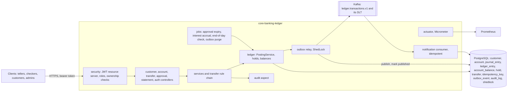
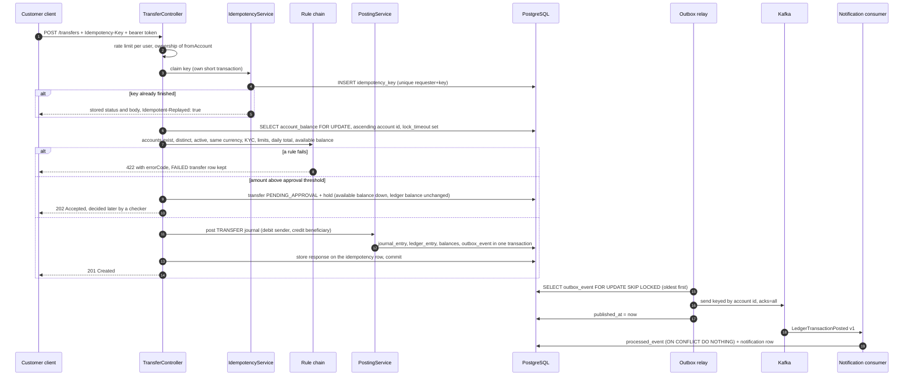

# core-banking-ledger

[](https://github.com/Darshan-05032003/core-banking-ledger/actions/workflows/ci.yml)

A core banking backend written in Java 21 and Spring Boot. It keeps customers and their accounts, takes cash deposits and withdrawals at the counter, moves money between accounts, and records every movement in a double-entry ledger on PostgreSQL: each business event is a journal whose debits equal its credits, the ledger tables can only be appended to, and mistakes are corrected with a reversal rather than an edit, so the books always add up and always show what happened. Around the ledger sit the controls a bank needs: idempotent payment requests, transfers that stay correct under concurrent load, maker-checker approval with a hold on the money for large amounts, a tamper-proof audit trail, daily interest accrual, an end-of-day reconciliation, and events published to Kafka through a transactional outbox so downstream systems see every posting exactly in the order it happened.

## Tech stack

| Area | Choice |
|---|---|
| Language and framework | Java 21, Spring Boot 4.1, Spring MVC, Spring Data JPA (Hibernate), Spring Security OAuth2 Resource Server |
| Database | PostgreSQL 16, Flyway migrations, row locks, triggers, window functions, partial indexes |
| Messaging | Apache Kafka 4 (KRaft), spring-kafka, transactional outbox, dead-letter topic |
| Jobs and locks | Spring scheduling with ShedLock (JDBC) |
| API | REST with RFC 9457 problem responses, OpenAPI 3.1 through springdoc, Swagger UI |
| Observability | Actuator health and readiness probes, Micrometer with Prometheus, Elastic Common Schema JSON logs in prod, correlation ids |
| Build and delivery | Maven wrapper, JaCoCo, ArchUnit, Testcontainers, multi-stage Docker image, docker compose, GitHub Actions |

## Architecture

One deployable Spring Boot application, organised by feature package. Every money movement funnels through `PostingService` in the `ledger` package; ArchUnit tests keep it that way.



## Transfer flow

What happens to `POST /api/v1/transfers`, from the request to the notification a downstream system records:



## Key design decisions

- **Double-entry and append-only.** Money is never a number that gets overwritten. Every event is a journal with legs that debit and credit customer or general-ledger accounts (`CASH_VAULT`, `INTEREST_EXPENSE`, `SUSPENSE`); `PostingService` refuses an unbalanced journal, and database triggers reject `UPDATE`, `DELETE` and `TRUNCATE` on `journal_entry`, `ledger_entry` and `audit_log`. A correction is a reversal journal linked through `reversal_of`, which a unique constraint lets happen once.
- **Lock ordering instead of SERIALIZABLE.** A transfer locks both `account_balance` rows with `SELECT ... FOR UPDATE` in ascending account id order inside a READ COMMITTED transaction with a `lock_timeout`. Two opposite transfers between the same accounts then queue instead of deadlocking, and a request never waits forever. Optimistic locking would have made every busy account retry under load.
- **Idempotency by unique constraint.** The `Idempotency-Key` is claimed by inserting a row in its own short transaction, so two concurrent requests with the same key are decided by the database, not by application code. The first response is stored with the transfer and replayed as is; the same key with another payload is refused.
- **Maker-checker and holds.** Above a threshold the person who raises a transfer cannot post it. The money is put on hold (available balance down, ledger balance unchanged) and a different user with the CHECKER role approves or rejects; the four-eyes rule is enforced on the server, undecided transfers expire by a scheduled sweep.
- **Transactional outbox.** The event is written to `outbox_event` in the posting transaction and published by a relay that reads with `FOR UPDATE SKIP LOCKED`, so a journal and its event are committed or rolled back together. Delivery is at least once; the consumer de-duplicates through `processed_event`, and poison records go to a dead-letter topic.
- **ShedLock on every schedule.** Relay, expiry sweep, interest accrual, end-of-day check and purge each fire once across all instances, and every job is safe to run twice.
- **Keyset pagination for statements.** Pages continue from an opaque cursor over `(posted_at, id)` instead of `OFFSET`, so a growing ledger never shifts or repeats a line, and the running balance comes from a SQL window function over the period. The CSV download streams through a JDBC cursor.
- **Interest accrued daily, paid monthly.** Daily figures are kept at four decimals under a unique `(account, date)` key so a re-run cannot double-accrue; the month-end payout rounds the sum `HALF_EVEN` to money and posts one `INTEREST` journal.
- **End-of-day checks.** A nightly job recomputes every balance from the ledger lines, checks that every journal balances and that all debits equal all credits, and reports a discrepancy as an `ERROR` log line, a metric and an audit row.
- **Money is a value object.** `Money` wraps a `BigDecimal` at scale 2 with a currency and refuses to mix currencies; `AccountNumber` validates its Luhn check digit. Numbers in the database are `NUMERIC(19,2)` with a `CHAR(3)` currency.

## Running

### With docker compose

```bash
docker compose up --build -d --wait
```

This builds the image and starts PostgreSQL (host port 5433), Kafka (host port 9094) and the application (host port 8082) with health checks; `--wait` returns once the application's readiness probe is up. `.env` is optional: copy `.env.example` to `.env` to change any setting. Without it the stack runs the `dev` profile, which generates a throwaway RSA key pair for the tokens and seeds one ADMIN login (`APP_ADMIN_USERNAME` / `APP_ADMIN_PASSWORD`, defaulting to `admin` / `change-me-before-starting`) so the first users can be created through the API. Inside the compose network the application reaches `postgres:5432` and `kafka:9092`; the host ports exist for tools on your machine.

```bash
curl -s http://localhost:8082/actuator/health
# Swagger UI: http://localhost:8082/swagger-ui.html
curl -s -X POST http://localhost:8082/api/v1/auth/token -H 'Content-Type: application/json' \
     -d '{"username":"admin","password":"change-me-before-starting"}'
docker compose down -v      # stop and drop the database volume
```

To walk through the main flow by hand, use the admin token to create a `TELLER`, a `CHECKER` and a `CUSTOMER` login with `POST /api/v1/admin/users` (the customer login takes the `customerId` it belongs to, so onboard the customer first), then onboard, verify KYC, open accounts and deposit as the teller, transfer as the customer and approve as the checker, as listed under [Endpoints](#endpoints). A transfer names both accounts by their full twelve-digit number, which the API never returns; on a local stack read them from the database:

```bash
docker compose exec postgres psql -U ledger -d ledger -c 'select id, account_number from account'
```

To run with real signing keys, generate a pair and pass it as PEM text (line breaks may be written as `\n`) or as a file location:

```bash
openssl genpkey -algorithm RSA -pkeyopt rsa_keygen_bits:2048 -out jwt-private.pem
openssl pkey -in jwt-private.pem -pubout -out jwt-public.pem
```

Either put `APP_SECURITY_JWT_PRIVATE_KEY` and `APP_SECURITY_JWT_PUBLIC_KEY` into `.env` with the PEM text, or mount the files with a `docker-compose.override.yml` (ignored by git) and point the variables at them:

```yaml
services:
  app:
    environment:
      SPRING_PROFILES_ACTIVE: prod
      APP_SECURITY_JWT_PRIVATE_KEY: file:/run/secrets/jwt-private.pem
      APP_SECURITY_JWT_PUBLIC_KEY: file:/run/secrets/jwt-public.pem
    volumes:
      - ./jwt-private.pem:/run/secrets/jwt-private.pem:ro
      - ./jwt-public.pem:/run/secrets/jwt-public.pem:ro
```

In the `prod` profile the application refuses to start without keys, logs JSON, and seeds no user; create the first ADMIN with an `INSERT` into `app_user` or run the dev profile once against the same database.

### The image

The `Dockerfile` has two stages. The build stage runs the Maven wrapper on `eclipse-temurin:21-jdk`, resolves dependencies in a layer of their own with a BuildKit cache mount, packages the jar without running the tests (CI runs them), and extracts it with `java -Djarmode=tools -jar app.jar extract --layers --launcher`. The runtime stage copies the layers onto `eclipse-temurin:21-jre` in order of volatility (dependencies, loader, snapshot dependencies, application), so a code change rebuilds and ships only the application layer; it runs as a dedicated non-root user (uid 10001, above the uid the base image already uses), sets `JAVA_TOOL_OPTIONS=-XX:MaxRAMPercentage=75.0 -XX:+ExitOnOutOfMemoryError` so the heap follows the container's memory limit and an exhausted heap restarts the container instead of limping on, and declares a `HEALTHCHECK` against `/actuator/health/readiness`. The compose file gives the container a 768 MB memory limit.

### Locally with Maven

```bash
cp .env.example .env          # adjust if needed
docker compose up -d postgres kafka
./mvnw spring-boot:run        # http://localhost:8082, dev profile
```

Every setting is an environment variable with a local default; `.env.example` lists them all with their meaning.

## API

The interactive documentation is at `/swagger-ui.html` and the OpenAPI document at `/v3/api-docs`; both are open, everything else needs a bearer token. Operations are tagged by module, every operation documents the problem responses it can return with an example `errorCode`, and the main flows (token, onboard, open account, deposit, transfer, approve) carry worked request and response examples.

### Authentication and roles

`POST /api/v1/auth/token` with `{"username", "password"}` checks the password against the BCrypt hash in `app_user` and returns a JWT signed with RS256 that lives for `app.security.jwt.access-token-ttl` (default 15 minutes). Every other endpoint expects `Authorization: Bearer <token>`. The token carries the username, the roles and, for a customer login, the linked customer id. There are no sessions and no cookies, so CSRF protection is off. A missing or invalid token is answered with 401 and `WWW-Authenticate: Bearer`; a valid token without the required role gets 403.

| Role | May |
|---|---|
| `CUSTOMER` | Read its own customer record, accounts, balances and statements; send transfers from its own accounts and read them. A customer login is linked to exactly one customer id by an admin |
| `TELLER` | Onboard customers, decide KYC, open accounts, deposit and withdraw cash, read accounts, journals and transfers |
| `CHECKER` | Read customers, accounts, journals and transfers; list, approve and reject transfers waiting for approval |
| `ADMIN` | Everything above, plus freeze, unfreeze and close accounts, reverse journals, manage logins, run jobs and read every actuator endpoint. An admin may decide approvals, but never one of its own transfers |

Role rules sit on each controller method with `@PreAuthorize`; ownership is decided by small beans in the expression, for example `@accountAccess.isOwner(#accountId, authentication)`. An account that is not the caller's is reported as 403 whether or not it exists.

### Endpoints

All paths are under `/api/v1`. "staff" means `TELLER`, `CHECKER` or `ADMIN`; "owner" means a `CUSTOMER` login linked to the customer the record belongs to.

| Method and path | Purpose | Roles |
|---|---|---|
| `POST /auth/token` | Exchange username and password for an access token | anyone |
| `POST /customers` | Onboard a customer (full name, email, phone, date of birth); KYC starts as `PENDING` | TELLER, ADMIN |
| `GET /customers/{id}` | Fetch a customer | staff, owner |
| `POST /customers/{id}/kyc/verify`, `/kyc/reject` | Decide KYC (`reason` required for a rejection) | TELLER, ADMIN |
| `GET /customers/{id}/accounts` | List the customer's accounts | staff, owner |
| `POST /accounts` | Open a `SAVINGS` or `CURRENT` account for a KYC-verified customer; currency defaults to `INR` | TELLER, ADMIN |
| `GET /accounts/{id}` | Fetch an account | staff, owner |
| `GET /accounts/{id}/balance` | Ledger balance, available balance and the amount on hold | staff, owner |
| `POST /accounts/{id}/freeze`, `/unfreeze` | Block or unblock an account | ADMIN |
| `POST /accounts/{id}/close` | Close an account; only when the balance is exactly zero and nothing is on hold | ADMIN |
| `POST /accounts/{id}/deposits`, `/withdrawals` | Teller cash operations (`amount`, `currency`, optional `remarks`); a withdrawal beyond the available balance is refused with `INSUFFICIENT_FUNDS` | TELLER, ADMIN |
| `GET /accounts/{id}/statement?from=&to=&cursor=&size=` | Ledger lines for an inclusive date range with a running balance plus opening and closing balance; pages continue through `nextCursor` (`size` at most 200) | staff, owner |
| `GET /accounts/{id}/statement.csv?from=&to=` | The same lines for the whole range as a streamed CSV download | staff, owner |
| `POST /transfers` | Move money between two customer accounts (`fromAccount`, `toAccount`, `amount`, `currency`, optional `remarks`); requires an `Idempotency-Key` header. 201 when posted, 202 when parked for approval | owner of `fromAccount`, ADMIN |
| `GET /transfers/{id}` | A transfer attempt in any state: completed, failed, pending approval, rejected or expired | staff, owner of the sending account |
| `GET /approvals?status=&page=&size=` | The approval queue, oldest first | CHECKER, ADMIN |
| `POST /approvals/{transferId}/approve`, `/reject` | Decide a pending transfer (`reason` required for a rejection); the maker is refused with `SELF_APPROVAL_FORBIDDEN` | CHECKER, ADMIN |
| `GET /journals/{id}` | A posted journal with its ledger lines | staff |
| `POST /journals/{id}/reversal` | Correct a journal by posting the opposite legs (`reason` required); each journal can be reversed once | ADMIN |
| `POST /admin/users` | Create a login (`username`, `password`, `roles`, optional `customerId` for a `CUSTOMER`) | ADMIN |
| `GET /admin/users/{id}` | Fetch a login; the password hash is never returned | ADMIN |
| `PUT /admin/users/{id}/customer` | Link a `CUSTOMER` login to a customer id | ADMIN |
| `POST /admin/users/{id}/disable`, `/enable` | Block or restore a login | ADMIN |
| `POST /admin/jobs/interest-accrual?date=` | Accrue savings interest for a day that has ended (and pay it out on a month-end) | ADMIN |
| `POST /admin/jobs/eod-check?date=` | Reconcile every balance, journal and the totals per currency now | ADMIN |

Account numbers have twelve digits: a four-digit branch code, a seven-digit sequence and a Luhn check digit, so a mistyped digit is detected before any lookup. Responses and logs never contain full account numbers, phone numbers or email addresses; they are masked as `XXXXXXXX4821` and `a***@example.com`.

### Error responses

Errors are RFC 9457 `application/problem+json` documents. Every body carries a machine-readable `errorCode` and the `correlationId` of the request, which is also returned in the `X-Correlation-Id` response header and printed in every log line of that request; send your own `X-Correlation-Id` to have it reused.

```json
{
  "type": "about:blank",
  "title": "Unprocessable Entity",
  "status": 422,
  "detail": "Available balance 1000.00 is lower than 2500.00",
  "instance": "/api/v1/transfers",
  "errorCode": "INSUFFICIENT_FUNDS",
  "correlationId": "7c1e9a5c-1a2b-4d3e-9f10-2b3c4d5e6f70"
}
```

| Status | Meaning | Example codes |
|---|---|---|
| 400 | Malformed request or validation failure (`errors` lists the fields) | `VALIDATION_FAILED`, `IDEMPOTENCY_KEY_REQUIRED`, `INVALID_PERIOD`, `INVALID_CURSOR` |
| 401 | No, expired or invalid token; wrong credentials | `AUTHENTICATION_REQUIRED`, `TOKEN_EXPIRED`, `INVALID_CREDENTIALS`, `USER_DISABLED` |
| 403 | Role or ownership does not allow the call | `ACCESS_DENIED` |
| 404 | Unknown identifier | `RESOURCE_NOT_FOUND` |
| 409 | The resource is in a state that forbids the change, or a concurrent request won | `TRANSFER_NOT_PENDING`, `JOURNAL_ALREADY_REVERSED`, `KYC_STATUS_UNCHANGED`, `LOCK_TIMEOUT`, `REQUEST_IN_PROGRESS` |
| 422 | A business rule refused the request | `INSUFFICIENT_FUNDS`, `DAILY_LIMIT_EXCEEDED`, `CUSTOMER_NOT_VERIFIED`, `SELF_APPROVAL_FORBIDDEN`, `IDEMPOTENCY_KEY_REUSED` |
| 429 | Transfer rate limit per user exceeded; `Retry-After` says when to retry | `RATE_LIMIT_EXCEEDED` |

## How it works

### Ledger

Money moves only through `PostingService`, which records every business event (`DEPOSIT`, `WITHDRAWAL`, `TRANSFER`, `INTEREST`, `REVERSAL`) as a journal with two or more ledger lines, each debiting or crediting a customer account or one of the bank's general-ledger accounts. A journal is accepted only when all its lines share one currency and the debits equal the credits; the journal, its lines and the affected balance rows are written in a single transaction with the balance rows locked in ascending account id order. A cash deposit debits `CASH_VAULT` and credits the customer; a withdrawal does the opposite and is refused when the available balance is lower than the amount. `account_balance` holds the ledger balance and the available balance per account, which differ only by the active holds, and must always agree with the sum of the account's lines.

### Transfers

Every transfer request carries an `Idempotency-Key` (1 to 64 letters, digits, `.`, `_`, `:` or `-`), unique per requester. The first request with a key claims it by inserting a row; the winner performs the transfer and stores the HTTP status and body it produced in the same transaction. A later request with the same key and payload gets that response back with `Idempotent-Replayed: true`; the same key with a different payload is refused with 422 `IDEMPOTENCY_KEY_REUSED`; a request that arrives while the first is still running gets 409 `REQUEST_IN_PROGRESS`. Rejections are stored and replayed too, so a retry can never turn a refusal into a second attempt.

Validation is a chain of rule beans with an explicit order, evaluated until the first rejection: both accounts exist and are distinct, both are `ACTIVE`, the accounts and the request share one currency, the sender's KYC is `VERIFIED`, the amount is positive and within `app.limits.per-transaction`, the sender's transfers of the day plus this amount stay within `app.limits.daily`, and the available balance covers the amount. The rules run after both balance rows are locked, so what they see cannot change before the journal is posted. A transfer the rules rejected is still written, in a separate transaction after the rollback, as a `FAILED` row carrying the error code. `POST /api/v1/transfers` is limited per user to `app.security.rate-limit.transfers-per-minute` (default 20) with an in-memory token bucket.

### Maker-checker and holds

A transfer above `app.approval.threshold` (default 200000.00) is saved as `PENDING_APPROVAL`, answered with 202, and a hold for the amount is placed on the sender under the same row lock. The hold lowers the available balance but not the ledger balance: the money is still the customer's and still on the books, it just cannot be spent twice while a checker decides. Approval locks the transfer row, then the two balance rows, captures the hold and posts the journal in one transaction; rejection releases the hold and records the reason. The loser of two simultaneous decisions gets 409 `TRANSFER_NOT_PENDING`. Pending transfers nobody decides within `app.approval.pending-expiry` (default 24h) are expired by a scheduled sweep that releases their holds and writes an audit row.

### Statements

The statement query computes the running balance in PostgreSQL with `SUM(signed_amount) OVER (ORDER BY posted_at, id)` over the whole period and applies the keyset predicate outside the window, so a page that starts in the middle of the period still shows the right balances. `ledger_entry` carries a copy of its journal's `posted_at`, kept consistent by a composite foreign key, and an index on `(account_id, posted_at, id)` serves the range, the order and the cursor. In the volume test (100 000 journals, 200 000 lines) `EXPLAIN (ANALYZE, BUFFERS)` showed a one-month page going from 25.5 ms and 4 833 buffers with hash joins over the whole account and a sequential scan of `journal_entry` to 4 to 5 ms and 1 071 buffers served by that index. Both statement endpoints read at `REPEATABLE READ`, so the balances and the lines of one response come from the same snapshot; the CSV is streamed through a JDBC cursor with a fetch size of 500 inside a read-only transaction, so memory does not grow with the length of the statement.

### Events

Every posted journal becomes one `LedgerTransactionPosted` event per customer account it touched, keyed by that account's id so one account's events stay ordered on their partition, with an explicit `schemaVersion`. The outbox row is written by a synchronous listener on the `JournalPosted` application event that runs with `Propagation.MANDATORY`, so it is impossible to write it outside the posting transaction. The relay (`app.outbox.relay-delay`, default every second, under ShedLock) selects unpublished rows oldest first with `FOR UPDATE SKIP LOCKED`, sends each with `acks=all` and an idempotent producer, and stamps `published_at` in the same database transaction; a row whose publish fails records the attempt and holds back later rows of the same account only. The notification consumer in the same application writes one simulated SMS (debit) or email (credit) per event to `notification`, after inserting the event id into `processed_event` in the same transaction, which makes a redelivery a no-op. Retryable failures are retried with a fixed backoff; a record that can never be processed and a record whose retries are exhausted are republished to `ledger.transactions.v1.DLT` with their original key, value and headers.

### Interest and end-of-day check

Every night (`app.interest.accrual-cron`, default 00:30) the accrual job computes, for each open savings account, the balance it held at the end of the previous day from its ledger lines and writes one `interest_accrual` row with that balance, the rate in force and the day's interest, balance x rate / 365 rounded `HALF_EVEN` to four decimals; the unique key on `(account, date)` and `ON CONFLICT DO NOTHING` make a re-run harmless. On the last day of a month the run also sums the unposted accruals per account, rounds to two decimals and posts one `INTEREST` journal from `INTEREST_EXPENSE`, carrying anything below one paisa forward. The end-of-day check (`app.ledger.eod-check-cron`, default 01:00, or on demand) verifies in one `REPEATABLE READ` snapshot that every balance row equals the signed sum of its lines minus its holds, that every journal balances, and that all debits equal all credits per currency; each discrepancy is an `ERROR` log line with masked identifiers, an increment of `ledger.eod.mismatches`, and an audit row.

### Audit trail

Every money movement, approval decision, statement view or download and administrative action writes a row to `audit_log`: actor, roles, action, target, outcome `SUCCESS` or `FAILURE`, the error code of a failure, client IP, correlation id, timestamp and a JSON `details` column with the business values of the request (amounts, masked account numbers, reasons; never passwords or full numbers). The controller methods are marked `@Audited` and an aspect writes the row after the method has returned or thrown, in its own transaction, so a refused withdrawal or a forbidden freeze is on record like a successful one. Scheduled jobs write their rows as `system`.

### Scheduled jobs

Jobs are `@Scheduled` methods guarded by ShedLock's `@SchedulerLock` with the JDBC lock provider, so each schedule fires once however many instances share the database. `app.scheduling.enabled=false` turns the schedules off for an instance that should only serve requests.

| Job | Default schedule | What it does |
|---|---|---|
| Pending transfer expiry | every minute | Releases the holds of pending transfers nobody decided in time |
| Outbox relay | every second | Publishes outbox rows to Kafka |
| Interest accrual | 00:30 daily | Accrues the previous day and, at a month-end, posts the interest |
| End-of-day check | 01:00 daily | Reconciles balances, journals and totals |
| Outbox purge | 02:00 daily | Deletes published outbox rows older than `app.outbox.retention` (default 7 days) |

## Observability

Every request carries a correlation id (`X-Correlation-Id`, generated when the caller sends none) that appears in every log line of the request, in every error body and in the audit row. In the `prod` profile log lines are JSON in the Elastic Common Schema with the correlation id as a field; `dev` and `test` keep a readable pattern.

| Endpoint | Who | Content |
|---|---|---|
| `GET /actuator/health`, `/health/liveness`, `/health/readiness` | anyone | `UP` or `DOWN`; an ADMIN token also sees the `db` and `kafka` components. Readiness includes the database and the Kafka cluster, liveness only the process |
| `GET /actuator/info` | anyone | Build coordinates: artifact, group, version, build time |
| `GET /actuator/prometheus` | ADMIN | Prometheus scrape |
| anything else under `/actuator` | ADMIN | Not exposed, answers 404 |

| Metric | Type | Meaning |
|---|---|---|
| `transfers.completed` | counter | Transfers posted to the ledger, directly or after approval |
| `transfers.failed{errorCode}` | counter | Transfers refused by a rule, by error code |
| `transfers.latency{outcome}` | timer with histogram | Time to answer a transfer request, by `completed`, `pending_approval`, `replayed`, `rejected` or `error` |
| `outbox.lag` | gauge, seconds | Age of the oldest outbox event not yet acknowledged by Kafka |
| `outbox.unpublished` | gauge | Outbox events waiting to be published |
| `notifications.sent{channel}` | counter | Notifications recorded, `SMS` or `EMAIL` |
| `notifications.dead.lettered` | counter | Records parked on the dead-letter topic |
| `ledger.eod.mismatches{type}` | counter | Discrepancies found by the end-of-day check (`balance`, `journal`, `totals`) |

## Configuration

Settings live under the `app.*` prefix, bound to validated `@ConfigurationProperties` records, so an invalid value stops the application at start-up instead of failing later. Each maps to an environment variable listed in `.env.example`.

| Prefix | Purpose |
|---|---|
| `app.account` | Branch code used in account numbers and the default account currency |
| `app.ledger` | Lock timeout for every transaction that locks balance rows, and the cron of the end-of-day check |
| `app.idempotency` | How long an unfinished `Idempotency-Key` may block before a retry takes it over |
| `app.limits` | Per-transaction and daily transfer limits |
| `app.approval` | Maker-checker threshold, pending-transfer expiry and the cron of the expiry sweep |
| `app.statement` | The longest period one statement request may cover (default one year) |
| `app.outbox` | Relay delay and batch size, publish acknowledgement timeout, topic partitions and replication factor, retention and purge cron |
| `app.notification` | Consumer group, retry attempts and backoff before a record is dead-lettered |
| `app.interest` | Annual savings rate and the accrual cron |
| `app.security` | JWT issuer, access token lifetime, the RSA key pair, and the transfer rate limit |
| `app.scheduling` | Master switch for every schedule |

## Tests

```bash
./mvnw clean verify
```

Integration tests start PostgreSQL and Kafka in Testcontainers on random ports, so Docker must be running. The build writes a JaCoCo report to `target/site/jacoco/index.html` and fails if line coverage drops below 95 %. On the current code the report shows 98.53 % of lines, 97.95 % of instructions and 86.28 % of branches covered by 711 tests; request and response records, configuration classes, the generated MapStruct mappers and the main class are excluded from the measurement.

What the tests cover, by area:

- **Ledger invariants.** An unbalanced journal is rejected; the triggers block `UPDATE` and `DELETE` on the ledger tables and on `audit_log`; a reversal restores balances; a random sequence of deposits, withdrawals and reversals leaves every journal balanced, every balance equal to the sum of its lines and the vault equal to what the bank owes its customers.
- **Concurrency.** 100 concurrent transfers between two accounts conserve the total; transfers in both directions at once finish without deadlock; 50 transfers racing for a balance that covers ten leave exactly ten completed; concurrent requests with one `Idempotency-Key` produce one transfer; a balance row held by another transaction makes the lock timeout fire (SQLSTATE `55P03`) and the retry succeed; a concurrent approve and reject end in exactly one outcome.
- **Security.** Every endpoint is run against an anonymous caller and each of the four roles with real tokens; a customer is refused on another customer's accounts and transfers; expired, tampered and foreign-issuer tokens are rejected; audit rows are written for successful, refused and denied attempts.
- **Statements.** Running balances across pages match an in-memory computation; pages fetched after new postings neither shift nor repeat; malformed cursors and periods are rejected; the CSV header and rows are checked; a 200 000-line volume test checks the index with `EXPLAIN (ANALYZE, BUFFERS)` and streams a year of lines.
- **Events.** A transfer leaves one outbox row per account and one notification per account; a rolled-back posting leaves no outbox row; the relay publishes nothing twice; a failed event holds back later events of the same account only; a duplicate delivery produces one notification; malformed JSON, an unknown schema version and an unknown account end up in the dead-letter topic.
- **Jobs.** Interest for known balances and rates with the fixed clock, including the half-way cases that separate `HALF_EVEN` from half-up; idempotent re-runs; the month-end posting; the end-of-day check catching a corrupted balance and a one-sided line; every scheduled entry point taking its ShedLock row.
- **Architecture and contract.** ArchUnit rules on package cycles, controller access to repositories, the ledger write path and `@SchedulerLock` on every schedule; a source scan for SQL against the ledger tables; the OpenAPI document's security scheme, tags, summaries, required `Idempotency-Key` and error examples; the ECS log encoder output.
- **End to end.** One test walks a customer's first day with a real token per role: onboarding, KYC, two accounts, a deposit, a transfer, a high-value transfer approved by a checker, the statement, and the notifications the Kafka consumer records.

CI runs `./mvnw -B clean verify` on every push and pull request, uploads the JaCoCo report as a build artifact, and builds the Docker image with BuildKit (without pushing it).
